  Finance student, researcher and builder. I work where economics, Bitcoin and open-source technology meet.

  
  
  
  

---

<h3 align="center">What I'm building</h3>

**[Obelisk](https://obelisk.ar)** · *Builder* 
Discord-like group chat on Nostr: NIP-29 channels, encrypted DMs, WebRTC voice and Lightning zaps. No email, no password, no backend. 

 

**[Nostr WoT](https://nostr-wot.com)** · *Co-founder, product & growth* 
Trust infrastructure for Nostr: a Rust Web of Trust oracle, a browser extension that is also a signer and Lightning wallet, and a JavaScript SDK. 

 

**[Liberture](https://liberture.com)** · *Content & AI* 
A biological operating system: one platform for health, performance and human optimization. I build its knowledge base and AI biohacking assistants. 

 

**[QuantaKrypto](https://quantakrypto.com)** 
Be quantum-ready before Q-day: a credential for the post-quantum transition, delivered through post-quantum cryptography. 

 

**[WeAreBitcoin](https://wearebitcoin.org)** · *Bitcoin & economics writer* 
Spanish-language Bitcoin education. I write about sound money, inflation and monetary policy. 

 

---

  
  

  <picture>
    <source media="(prefers-color-scheme: dark)" srcset="https://raw.githubusercontent.com/Fabricio333/Fabricio333/output/github-snake-dark.svg" />
    
  </picture>

